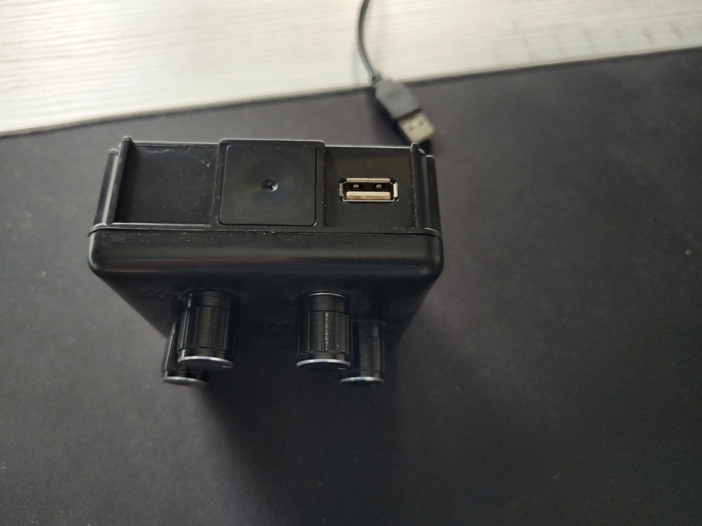
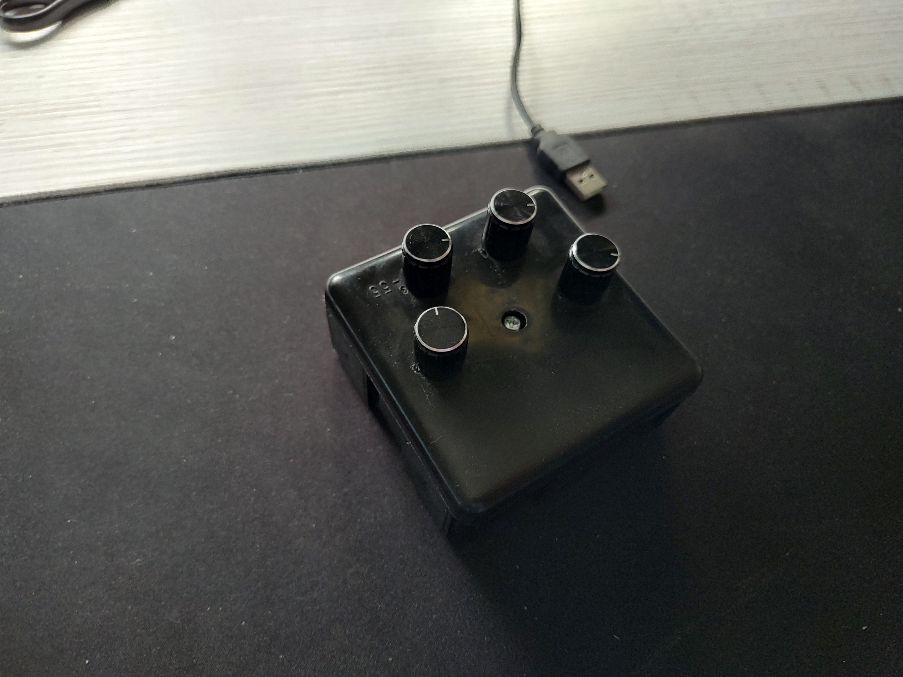
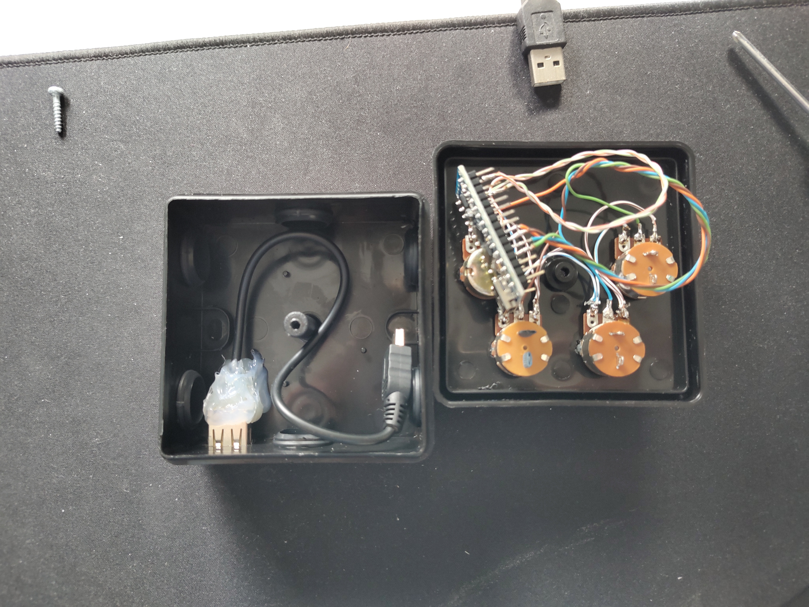

# Deej - for linux only

Deej app written in Rust to control your apps' volume with Arduino.







## How it works

Deej uses four potentiometers connected to an Arduino. Each potentiometer controls the volume of one or more application targets configured in `./config.json`.

The Arduino reads the potentiometer positions through its analog inputs and sends the values to the Deej application over a USB serial connection. Deej then adjusts the volume of the applications assigned to each potentiometer.

## Wiring

Each potentiometer has three pins:

- One outer pin connects to **5V**.
- The other outer pin connects to **GND**.
- The middle pin (wiper/signal) connects to an Arduino analog input.

Connect the potentiometers (as many as you wish to):

| Potentiometer | Signal pin | Power | Ground |
|---|---|---|---|
| 1 | `A0` | `5V` | `GND` |
| 2 | `A1` | `5V` | `GND` |
| 3 | `A2` | `5V` | `GND` |
| 4 | `A3` | `5V` | `GND` |

All potentiometers share the Arduino's `5V` and `GND` connections. Each middle pin must go to its own analog input.

Adjust the Arduino sketch if needed:

```cpp
const int NUM_SLIDERS = 4; // Amount of sliders
const int analogInputs[NUM_SLIDERS] = {A0, A1, A2, A3}; // Sliders pins, in this order the board will return data to your pc
```

If your max and min values are reversed, modify the `reverse` option in config shown below

## Configuration

Deej reads its configuration from `./config.json`.

Example:

```json
{
  "port": "/dev/ttyUSB0",
  "baud_rate": "9600",
  "count": 4,
  "apps": [
    ["_main"],
    ["brave", "vivaldi", "zen"],
    ["discord"],
    ["_other"]
  ],
  "reverse": true,
  "read_delay": 10
}
```

### Basic setup

- **`port`** — serial port used by the Arduino. For example, `/dev/ttyUSB0`. Your device may use a different path, such as `/dev/ttyACM0`.
- **`baud_rate`** — serial communication speed. It must match the baud rate used by the Arduino sketch.
- **`count`** — number of connected potentiometers.
- **`apps`** — application groups assigned to the potentiometers. Each nested list corresponds to one potentiometer, in order.
- **`reverse`** — reverses the potentiometer input direction.
- **`read_delay`** — delay between serial reads, in milliseconds.

### Assigning applications

The example above assigns the controls as follows:

| Potentiometer | Arduino input | Configuration | Volume target |
|---|---|---|---|
| 1 | `A0` | `["_main"]` | Main system volume |
| 2 | `A1` | `["brave", "vivaldi", "zen"]` | Brave, Vivaldi and Zen |
| 3 | `A2` | `["discord"]` | Discord |
| 4 | `A3` | `["_other"]` | All other applications |

You can put multiple application names in one list. That potentiometer will then control all matching applications.

### **Two special targets are available:**

- **`_main`** — controls the main system volume.
- **`_other`** — controls all applications except those explicitly listed in the other application groups.

### **To find the names of currently active audio applications, run:**

**It will show only the apps with audio session, if you cannot find your application, play music or join voice channel in it.**
```bash
pactl list sink-inputs | grep application.process.binary 
```

I used binary because some apps might have many audio profiles like `WEBRTC VoiceEngine` (discord)

## Releases

Download the executable from the project's [GitHub Releases](https://github.com/rraix0/Deej/releases) page.

